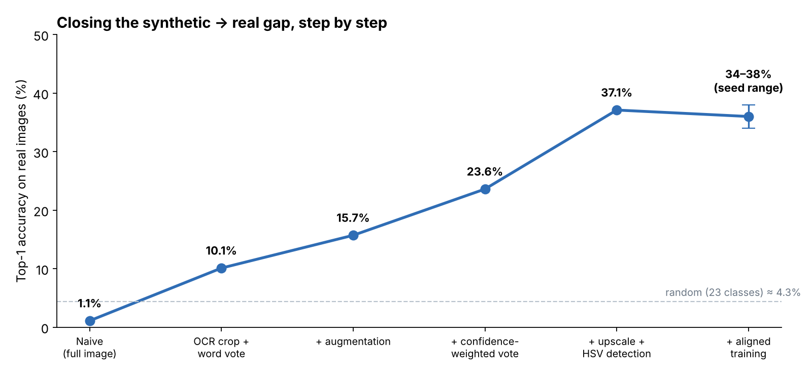
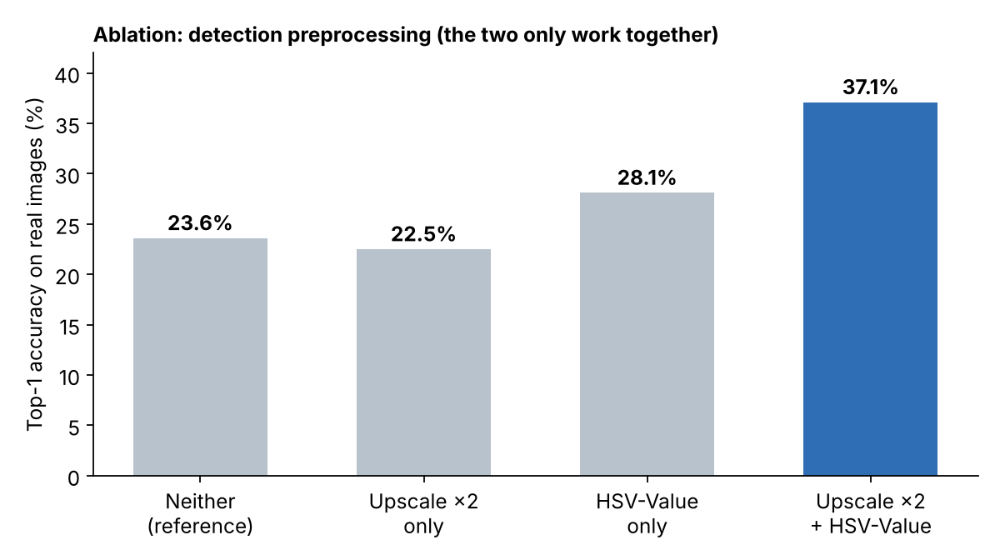
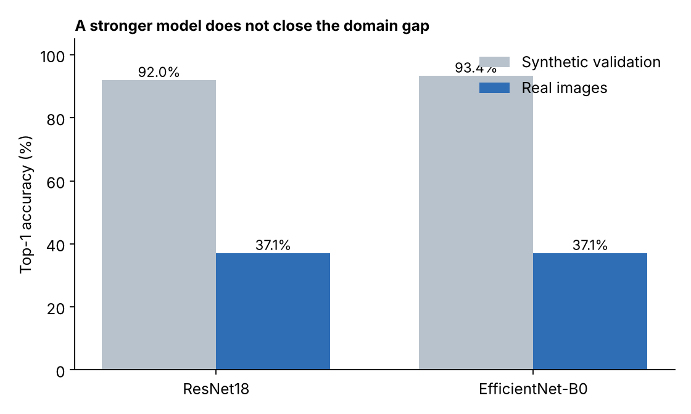
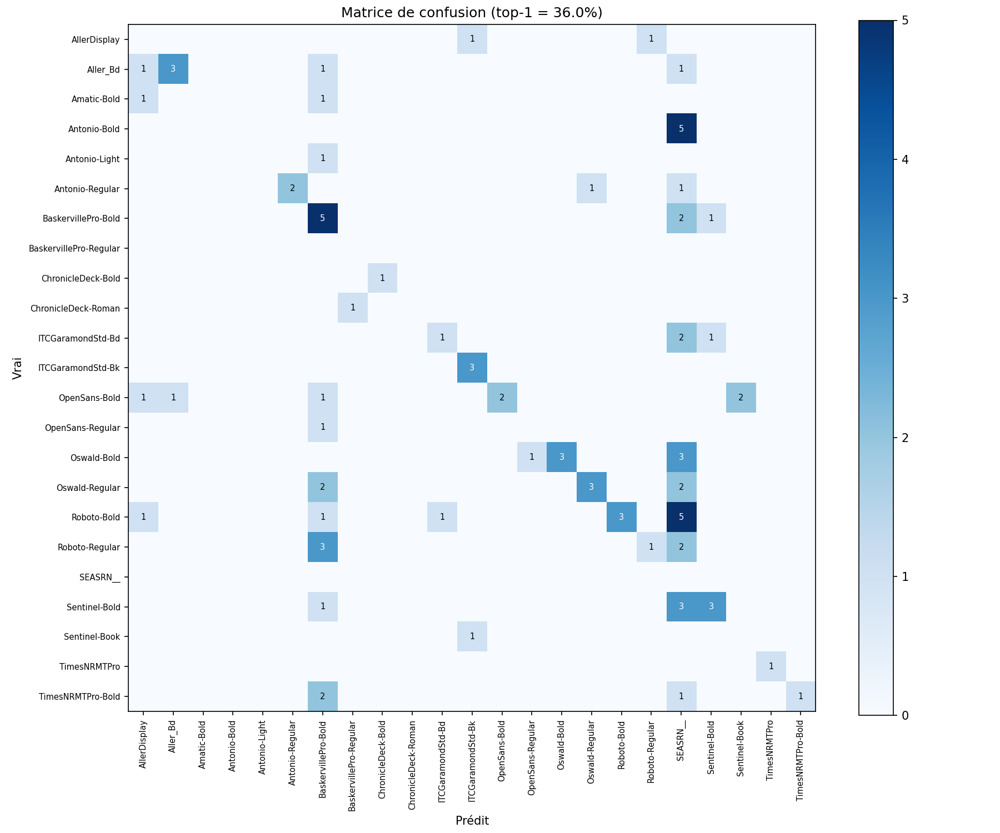
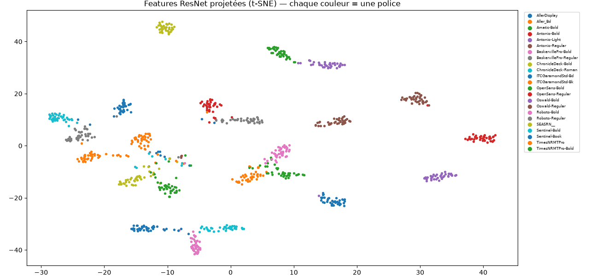

# Font Classifier — closing the synthetic-to-real gap

Identify the font used in the text of a real-world image, with a model trained
**only on synthetic images**. The project covers the full pipeline: data
analysis, training, a series of measured experiments, and a FastAPI service.



**Key result:** top-1 accuracy on real images went from **1.1% to ~36–38%**
(23 classes, random baseline ≈ 4.3%), with **~49% top-5** and ~0.36 s per image
on CPU. On clean synthetic data the classifier reaches ~92%: the hard part is the
domain gap, not the classification itself.

---

## How it works

```
image → upscale ×2 + HSV-Value → EasyOCR (text detection) → crop each word
      → ResNet18 (HSV-Value + resize-with-padding) → confidence-weighted vote → font
```

- **EasyOCR** only locates the text; it does not read it. Without this step the
  model sees the scene, not the letters (1.1%).
- **HSV-Value**: color is mostly background, a font is defined by shape.
- **ResNet18** (ImageNet, fine-tuned), trained with the *same* preprocessing as
  inference, plus augmentations (blur, noise, JPEG, small affine) to mimic real
  photos.
- **Confidence-weighted vote** over all detected words in the image.

## Key findings

| Finding | Evidence |
|---|---|
| The bottleneck is the input crop, not the model | Detection works on ~99% of images; classifier is ~92% on clean data |
| A stronger architecture does not help | EfficientNet-B0: 93.4% val, same ~37% on real images |
| Upscale and HSV only work together | 22.5% / 28.1% alone, 37.1% combined |
| Errors are structured, not random | Mostly confusions between weights of the same family (Regular / Bold) |
| The learned features are discriminative | t-SNE of the embeddings: one clean cluster per font |

<p float="left">
  
  
</p>

<p float="left">
  
  
</p>

With 89 real images, each image is worth ~1.1%, so results are reported as a
range across seeds rather than a single best run. Negative results are kept on
purpose (test-time augmentation, RGB+HSV ensemble, a first version of the
synthetic sentences): see the [full report](docs/REPORT.md).

## Project structure

```
├── api.py                    # FastAPI service
├── train.py                  # training, evaluation, curves, confusion matrix
├── src/preprocessing.py      # preprocessing shared by training and inference
├── scripts/generate_dataset.py  # build a synthetic dataset from your own fonts
├── tests/                    # pytest
├── docs/REPORT.md            # full technical report
├── docs/figures/             # analysis figures
├── Dockerfile
└── .github/workflows/ci.yml  # lint + tests on every push
```

## Quick start

```bash
python -m venv .venv && source .venv/bin/activate
pip install -r requirements.txt

# 1. Build a dataset from fonts you are allowed to use (e.g. Google Fonts)
python scripts/generate_dataset.py --fonts fonts/ --out data/train --per-font 2000

# 2. Train (GPU recommended); --test-dir is optional, for evaluation on real images
python train.py --train-dir data/train --test-dir data/real --out models/

# 3. Serve
MODEL_PATH=models/resnet18_final.pt uvicorn api:app --reload
# → http://127.0.0.1:8000/docs
```

With Docker:

```bash
docker build -t font-classifier .
docker run -p 8000:8000 -v $(pwd)/models:/app/models font-classifier
```

## API

| Method | Endpoint | Description |
|---|---|---|
| GET | `/health` | Service status |
| POST | `/predict` | One image → predicted font + confidence |
| POST | `/predict_batch` | Several images → list of predicted fonts |

```bash
curl -X POST "http://127.0.0.1:8000/predict" -F "file=@sample.png"
# {"filename": "sample.png", "font": "Roboto-Bold", "confidence": 0.41}
```

The model is loaded once at startup. Invalid or unreadable files return a clear
`400`; an image with no detected text returns an explicit message. The
confidence score can be used to send uncertain cases to human review.

## Limitations and next steps

- 89 real evaluation images: each image moves accuracy by ~1%, so per-class
  scores are not reliable.
- Next: learned domain adaptation (SimGAN-style refiner), family-aware
  classification for Regular/Bold confusions, a larger real evaluation set.

## Tech stack

Python · PyTorch · torchvision · EasyOCR · scikit-learn · FastAPI · Pydantic · pytest · Docker · GitHub Actions

---

Datasets and trained weights are not included in this repository.
