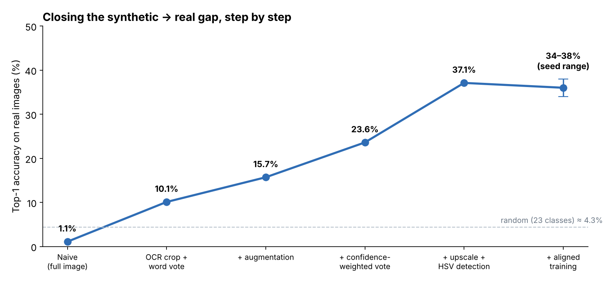
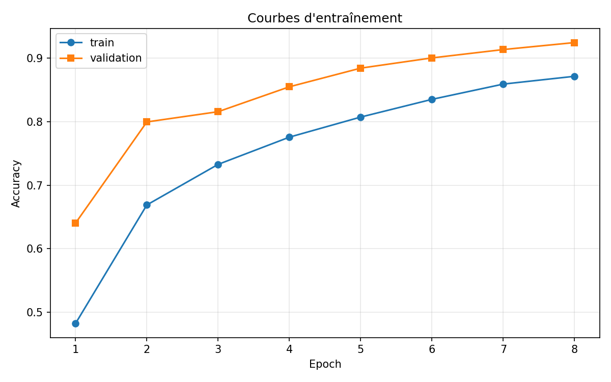
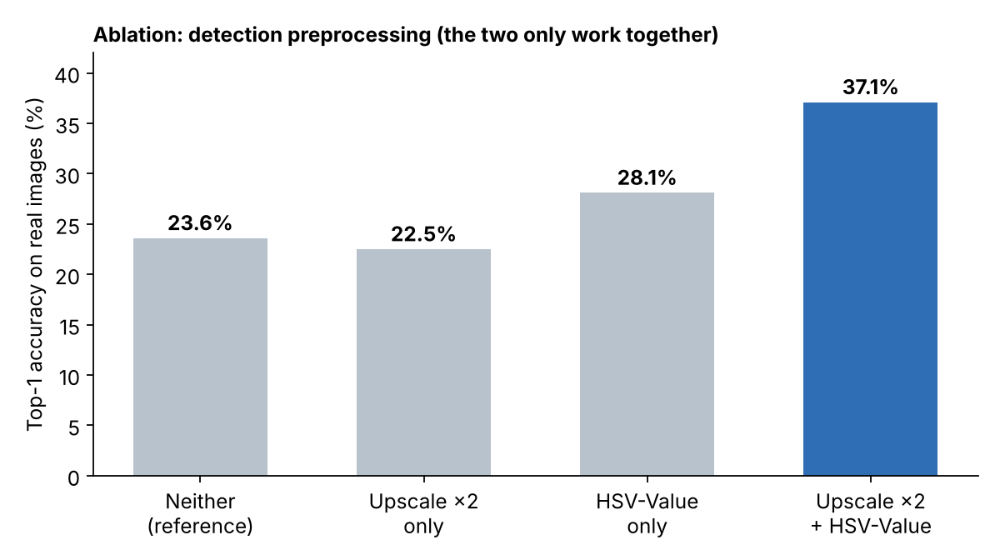
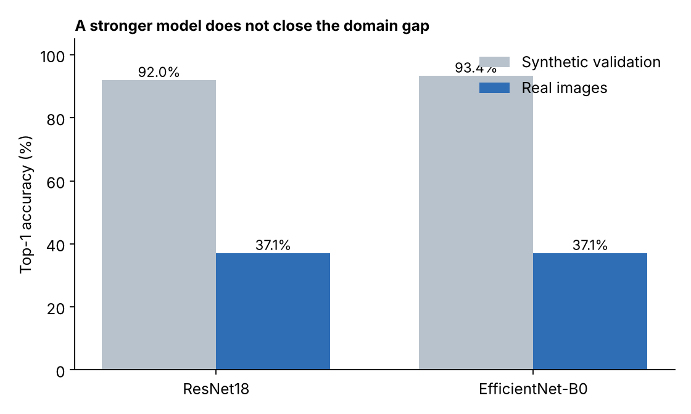
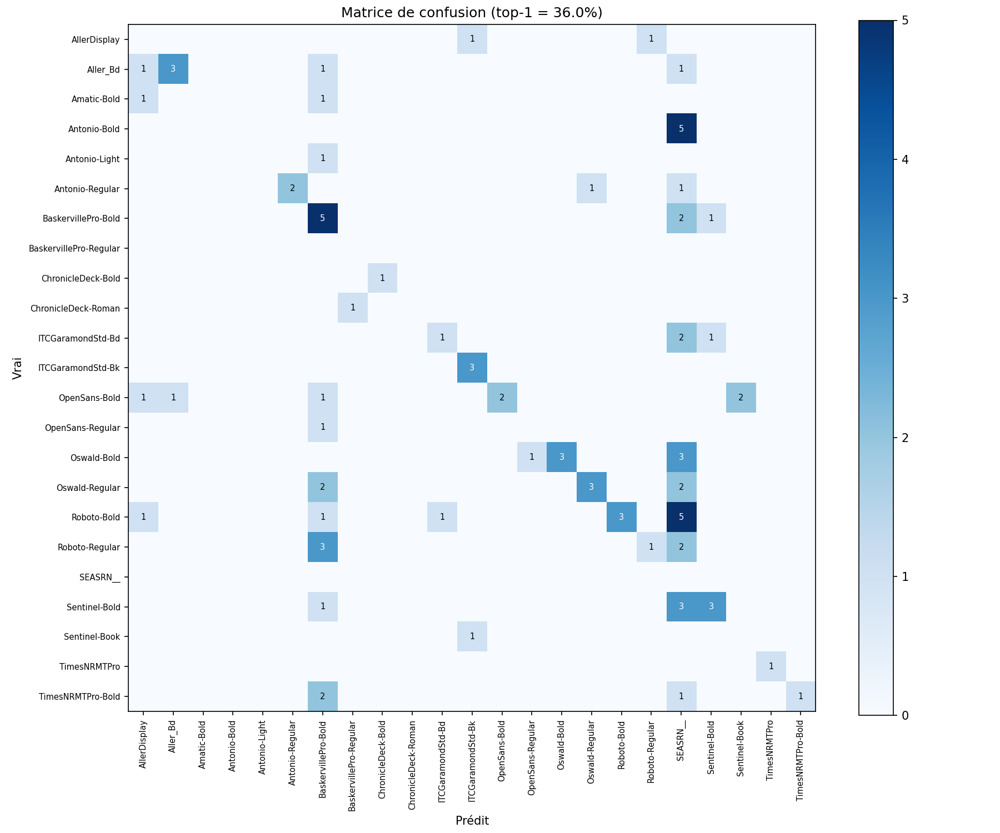
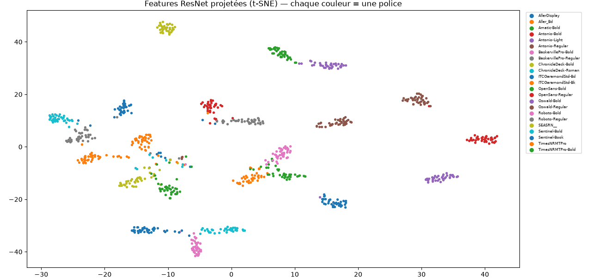

# Font Classifier — Technical Report

**Fadi Bairi** · Personal project
Task: identify the font used in the text of a real-world image.

---

## Overview

The model is trained on 104,729 synthetic word images (23 fonts) and evaluated
on 89 real photographs. Classification on clean data is easy: a ResNet18 reaches
~92% on a synthetic validation split within a few epochs. The difficulty is the
gap between the two sets: the real images are photographs where the text is
small and embedded in a scene.

I treated the task as a domain-adaptation problem. Real-image accuracy went from
1.1% to about 37% through a series of steps, each one addressing an identified
bottleneck rather than blindly tuning the model.

| Step | Real-image top-1 |
|------|---------------:|
| Naive (full image → model) | 1.1% |
| OCR crop + word-level vote | 10.1% |
| + augmentation | 15.7% |
| + confidence-weighted aggregation | 23.6% |
| + upscale + HSV detection | 37.1% |
| + aligned training / synthetic sentences | ~36–38% (plateau) |



---

## Data

Labels come from folder names (one directory per font). A quality pass on a
4,000-image sample showed clean data: no corrupted files, all RGB, all 128×128,
no duplicates. Classes are moderately imbalanced (4:1, from 1,452 to 5,826
images per font), handled with a stratified 80/20 split.

Two observations shaped the rest of the work:

- The mean inter-channel difference is high (≈42), so the images are strongly
  colored, mostly in the background. A font is defined by shape, not color, so
  color is a distractor.
- Several fonts are weight variants of the same family (Oswald Regular/Bold,
  Roboto, Antonio, Times). Telling them apart means reading stroke thickness,
  the hardest case. I expected most errors to be intra-family, and the results
  confirmed it.

---

## Approach

**Model.** ResNet18 pre-trained on ImageNet, final layer replaced with 23
outputs. Light (~11M parameters), fast at inference, well-suited to this scale.

**Inference pipeline.** A model trained on full-frame words fails on real
images, because the text occupies a small part of the scene (hence the 1.1%
naive baseline). The pipeline localizes the text first:

```
image → EasyOCR (text detection) → crop each word
      → ResNet18 → confidence-weighted vote → font
```

EasyOCR is used only to locate the text, not to read it. Each crop is resized
with padding (no stretching of the letters) and converted to the HSV value
channel. Predictions from all detected words are summed, each weighted by its
detection confidence.

**Preprocessing.** The final model is trained with exactly the same
preprocessing as inference (`src/preprocessing.py`).


*Validation reaches ~92%, with train below val: the augmentation makes training
harder on purpose, and there is no overfitting.*

---

## Experiments

Each change was measured on the real images before being kept.

**Augmentation.** Blur, JPEG compression, noise and small affine transforms make
clean training images look like degraded photographs: 15.7%.

**Detection quality.** The largest jump came from the classifier's input, not
the model. Running EasyOCR on an upscaled image in the HSV value channel reached
37.1%. Upscaling alone *hurt* (22.5%) and HSV alone helped only a little
(28.1%): the two only work together. Adding a margin around the crop made things
worse, because it brings back the background the model learned to ignore.



**Architecture.** EfficientNet-B0, trained with the same pipeline, reached a
higher validation accuracy (93.4%) but the same real accuracy (~37%). A stronger
model does not help, which points to the data gap rather than model capacity.



**Synthetic sentences.** To close the structural gap (single word vs full
sentence), I generated multi-word training images. A first version regressed
(23.6% → 20.2%): concatenated words kept their own background patch, an
artifact the model picked up. The corrected version extracts the glyphs from
their background by thresholding, then composes shrunk multi-word lines on
realistic backgrounds. This removed the regression and brought the model back to
the ~36–38% plateau.

**What did not help:** test-time augmentation (36% → 34%), an RGB+HSV ensemble
(37.1%, between the two single models), and the uncorrected synthesis above.
They are kept as informative negative results.

---

## Results

The final model sits at roughly **36% top-1** (34–38% depending on the random
seed), **~45% top-3**, **~49% top-5**, at ~0.36 s per image on CPU (dominated by
EasyOCR). 4 of the 89 images return no OCR detection and count as errors.

With only 89 images, each image is worth about 1.1%, so the final refinements
move the score within the noise of a single run. I therefore report a range and
rely on the more stable top-3/top-5 and on the structure of the errors rather
than on a single top-1 figure.

The gap between top-1 (~36%) and top-5 (~49%) shows that the correct font is
often among the top candidates: the model recognizes the family and hesitates on
the exact weight.


*Errors are structured, not random.*

- Intra-family confusion, as expected: Oswald Bold and Regular are confused with
  each other, and the Antonio and Times families behave the same way.
- Two "catch-all" classes, BaskervillePro-Bold and SEASRN__, absorb crops the
  model cannot place. SEASRN__ receives several predictions despite having no
  real example in the evaluation set.
- Fonts with a distinctive look (Aller_Bd, ITCGaramondStd-Bk, ChronicleDeck,
  TimesNRMTPro) are classified well.

---

## Where the error comes from

- Detection is not the problem: ~99% of images yield detected text.
- The classifier is capable: ~92% on clean synthetic data.
- The gap (92% → ~36%) therefore comes from the quality of the real crops.

The classifier's capability is visible in its learned features. A t-SNE
projection of the penultimate-layer embeddings of synthetic samples shows clean,
well-separated clusters, one per font:


*Each color is a font. Nearby families overlap, which matches the intra-family
confusions in the matrix above.*

This is why improving the input (OCR, HSV, synthetic sentences) helped, while a
stronger architecture did not.

---

## Limitations and next steps

1. The content gap is the main remaining limiter. A cleaner synthetic-sentence
   generator (better glyph extraction, real scene backgrounds) would likely push
   past the current plateau.
2. Learned domain adaptation: a SimGAN-style refiner that makes synthetic images
   realistic while keeping the label.
3. Family-aware modeling to reduce intra-family confusions.
4. A larger real evaluation set: 89 images is too few for a stable per-class or
   even top-1 figure.

---

## API

A FastAPI service (`api.py`) exposes the pipeline: `GET /health`,
`POST /predict` (one image) and `POST /predict_batch` (several images → list of
predicted fonts). The model is loaded once at startup, inputs are validated
(non-image or unreadable files return a clear 400, no text detected returns an
explicit message), and the response is a Pydantic schema. The confidence score
can route low-confidence cases to human review.
